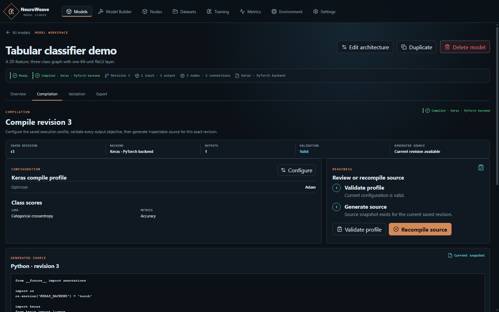

<p align="center"></p>

<h1 align="center">NeuroWeave Studio</h1>

<p align="center">A local workspace for designing, validating, and exporting machine-learning model graphs.</p>

<p align="center">
  <a href="https://github.com/CTCycle/Neuro-Weave-Studio/stargazers"></a>
  <a href="https://github.com/CTCycle/Neuro-Weave-Studio/commits"></a>
</p>

<p align="center">
  <a href="https://github.com/CTCycle/Neuro-Weave-Studio/releases"></a>
  <a href="https://github.com/CTCycle/Neuro-Weave-Studio/actions/workflows/ci.yml?query=branch%3Adevelop"></a>
  <a href="LICENSE.md"></a>
  
  
  
</p>

<p align="center">
  <a href="#model-builder">Model Builder</a> ·
  <a href="#functional-validation-and-export">Validation and export</a> ·
  <a href="#configuration">Configuration</a> ·
  <a href="assets/docs/project_index.md">Documentation</a>
</p>

NeuroWeave Studio runs locally as an Angular application with a FastAPI backend. Model projects and graph revisions are stored in SQLite.

## NeuroWeave Studio

Use the Model Builder to assemble directed graphs from a searchable node catalog, configure parameters, connect typed ports, and review graph and tensor-shape diagnostics. Save a model to keep its graph revision. Mathematical and sequential node templates can be reused across graphs.

Dataset registration refers to files already on disk and stores their definitions and inspection metadata; dataset contents are not copied into the application.

### Start NeuroWeave Studio

The supported launcher runs on 64-bit Windows 10 or 11 and requires PowerShell 7. Git and internet access are needed to clone the repository and install its pinned runtimes. You do not need to install Python or Node.js separately.

```powershell
git clone https://github.com/CTCycle/Neuro-Weave-Studio.git
Set-Location .\Neuro-Weave-Studio
.\start_on_windows.ps1 -Action Install -InstallationType Standard
.\start_on_windows.ps1 -Action Launch
```

The launcher installs the base environment, initializes the database, builds the frontend, and opens `http://127.0.0.1:9850/`. On first launch, select an execution backend for functional validation and binary exports. Keras-only mode supports graph editing and source generation. Keep the launcher open while using the app; press **Enter** or **Ctrl+C** to stop it.

See [installation and backend setup](assets/docs/runtime/installation.md) for profile details. The [startup guide](assets/docs/runtime/startup.md) covers separate frontend and backend development processes.

### Build a graph

1. Choose **New model** and add nodes from the catalog.
2. Connect ports, set input shapes, and configure node parameters.
3. Save the model to persist its graph and revision.

## Functional Validation and Export

Functional Validation runs a synthetic forward pass with initialized weights on an installed execution backend. The application does not train models or serve predictions, so binary exports contain untrained weights.

Compilation generates inspectable Keras source for a saved revision. Export can create project bundles and supported model formats when the required runtime is installed.

<p align="center"></p>

The screenshot shows a validated Keras compile profile with the PyTorch backend selected and a source snapshot for revision 3.

## Configuration

Application data defaults to `data`. Set `NEURO_WEAVE_RESOURCES_DIR` in the inherited environment or `settings/.env` to use another resource directory. Service addresses and other deployment settings are also configured outside the Settings workspace.

See [runtime configuration](assets/docs/runtime/configuration.md) for the full options and the [project documentation index](assets/docs/project_index.md) for architecture, product, and development guides.

## Development

The frontend uses Angular 22 and TypeScript. The backend uses FastAPI on Python 3.13, SQLite for persistence, and Keras 3 as its model API. PyTorch, TensorFlow, and JAX are optional execution backends. The Windows launcher provisions pinned Python, uv, and Node.js versions under `runtimes/`.

The launcher is Windows-only. TensorFlow and JAX are CPU-only on native Windows; JAX CPU support is experimental. PyTorch CUDA depends on the installed NVIDIA driver. TensorFlow and JAX GPU execution requires a separate WSL2/Linux environment. See the [testing strategy](assets/docs/development/testing_strategy.md) for validation guidance.

## Contributing

Please read the [contribution guide](assets/docs/development/contribution_guide.md) and the relevant coding standards before opening a pull request.

## License

NeuroWeave Studio is licensed under the [MIT License](LICENSE.md).
