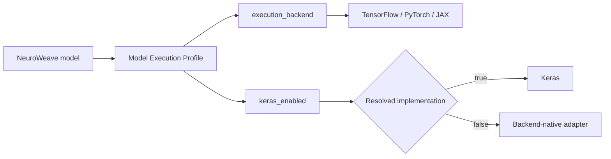
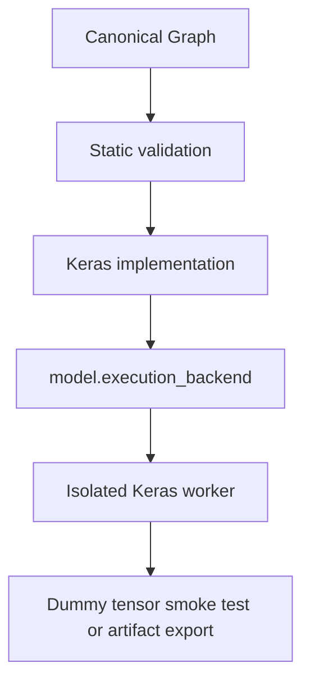
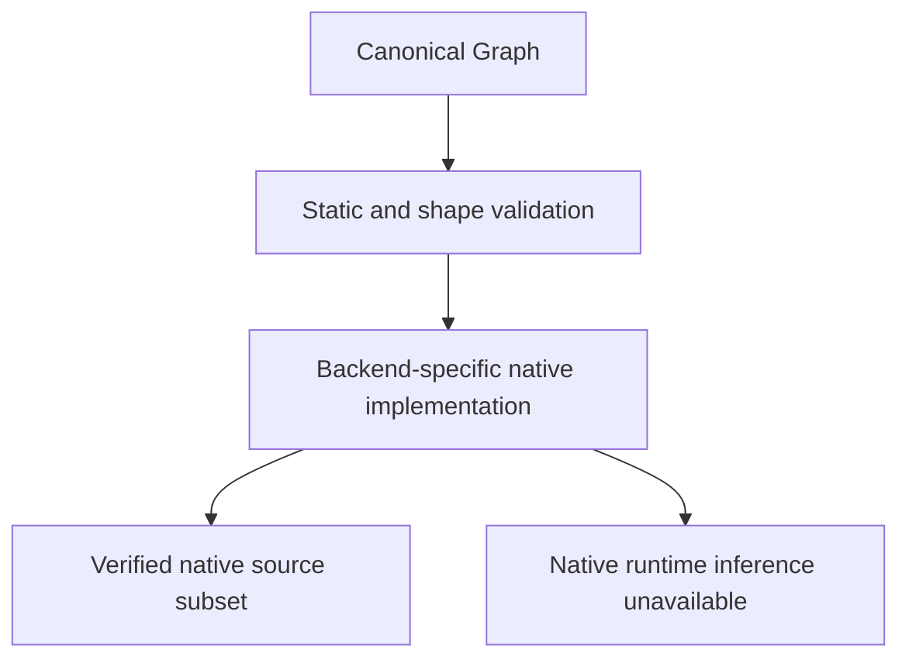
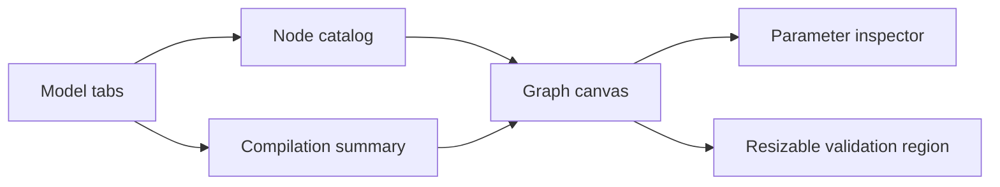
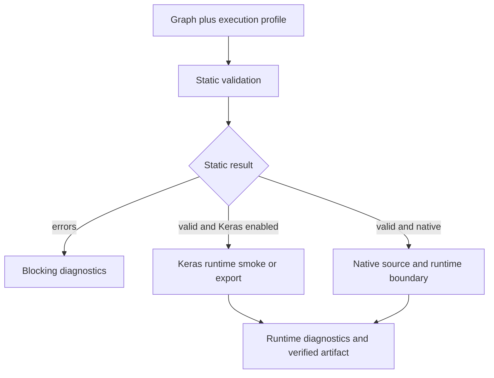
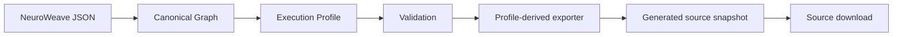
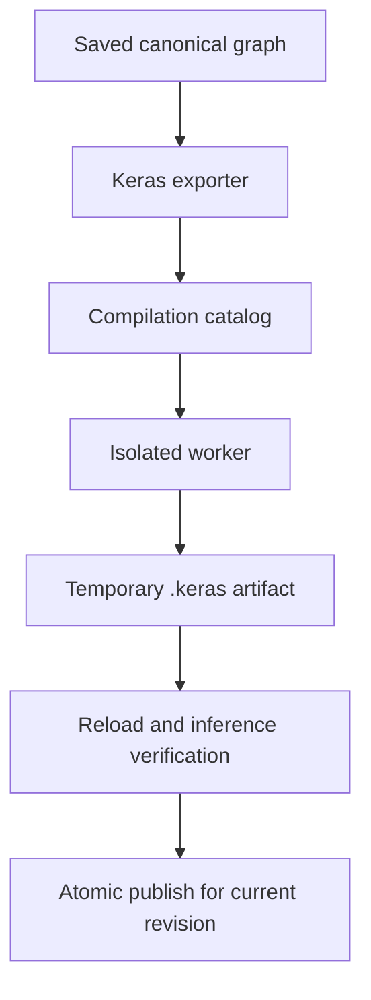
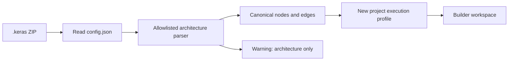
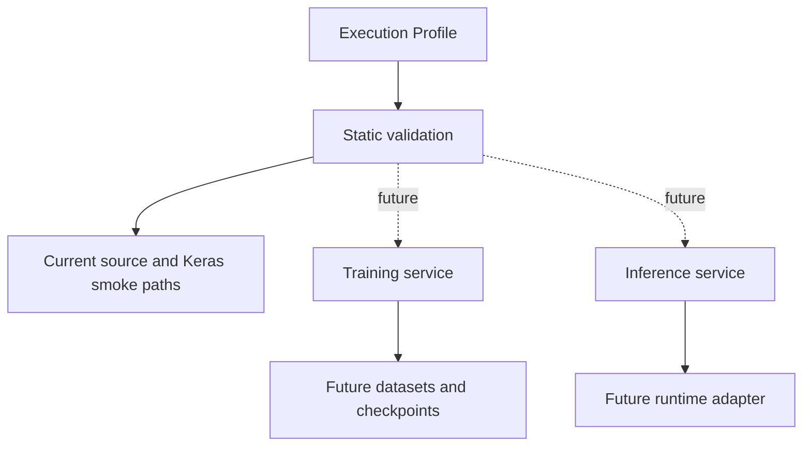

# Model Execution Profile

Last updated: 2026-08-27

## Purpose

NeuroWeave has one model identity and one execution decision. A persisted model stores the canonical graph together with two profile fields and one versioned model configuration:

- **execution_backend**: tensorflow, pytorch, or jax.
- **keras_enabled**: true when the canonical graph is implemented through Keras; false when the selected backend-native implementation is used.
- **model_configuration**: one nested value with `keras` compilation metadata and independent `native` TensorFlow, PyTorch, and JAX compiler settings. Native compiler options are disabled by default and remain preserved when the selected backend changes.

Keras is the model API layer. It is not a fourth execution backend. The profile is persisted on the project, revision, and generated-source snapshot so validation, source generation, and runtime jobs cannot silently select a different backend.

## Keras-enabled execution

When keras_enabled is true, the canonical graph is validated against the Keras implementation mapping. The selected execution_backend is passed into the isolated worker as KERAS_BACKEND before Keras is imported. This supports portable Keras operations against TensorFlow, PyTorch, or JAX when the dependency and node capability probes are operational.

The isolated dispatcher resolves that profile to the matching backend worker (`tensorflow_worker.py`, `pytorch_worker.py`, or `jax_worker.py`). The profile selects the worker implementation; it is never inferred from a request-local preference or a fallback after the worker starts.

Keras compilation uses the Keras branch of the metadata-driven capability catalog. Optimizers, losses, metrics, initializers, regularizers, constraints, and trusted formula metadata are exposed through `/api/metadata`. Native compilation is independent of Keras: TensorFlow exposes `tf.function(jit_compile=...)`, PyTorch exposes `torch.compile(...)` options, and JAX exposes `jax.jit(...)`. Each capability is live-probed and unavailable runtimes show an explicit reason. These settings do not add a training loop, checkpoint manager, or native optimizer runtime.

## Native execution

When keras_enabled is false, the persisted execution_backend resolves directly to the matching native implementation mapping. Native TensorFlow, PyTorch, and JAX/Flax source and runtime paths are available for the verified common subset. Native compiler settings are applied only when the selected worker reports the corresponding compiler; an unavailable compiler blocks that configured runtime job with a typed diagnostic rather than silently falling back to Keras.

The node manifest is capability truth. A node can be present in the catalog while its selected implementation is marked export-limited or unsupported. The validation panel keeps static validation, source eligibility, and runtime availability distinct.

## Editor architecture

The Builder is a fixed-height authoring workspace. Each open tab owns an isolated graph session, model metadata snapshot, saved baseline, selection state, history, and dirty flag. Tabs never duplicate a persisted project ID, and closing a dirty tab requires confirmation.

The toolbar edits the model name and opens the canonical model description metadata popover, selects the native execution backend, explicitly toggles the optional Keras API layer, and exposes Validate, Save & compile, Save model, undo, redo, and workspace actions. The center column keeps the compact compilation summary, canvas, and validation region within the viewport. A local minimap toggle and same-editor focus mode recover canvas space without recreating graph state; Escape exits focus mode immediately. Catalog and Inspector become explicit drawers at narrow widths.

## Validation pipeline

Static validation is synchronous and profile-aware. It covers graph topology, typed ports, node parameters, cycle prevention, shape propagation, the selected Keras or native compilation branch, implementation support, and source-generation eligibility. Runtime validation is isolated and applies to the selected Keras or native worker path; compiler availability is a separate live capability gate.

The frontend combines backend diagnostics with local graph diagnostics in one bottom panel. The splitter changes its height continuously, the diagnostic list scrolls inside the panel, and selecting an actionable finding focuses the related node or edge.

## Export architecture

NeuroWeave JSON is the canonical project representation. Generated source is a revision-scoped snapshot derived from the execution profile. Source download is honest about the selected implementation: Keras-enabled profiles use the Keras exporter, while native profiles use only a verified native exporter.

## .keras binary export

Keras `.keras` binary export is available for Keras-enabled models with an operational persisted backend. The worker builds an initialized, untrained Keras model from the canonical graph, applies the validated Keras configuration, saves a temporary artifact, reloads it, runs an inference check, and publishes it only after the project revision is still current. Native binary/checkpoint formats use the raw native model where the artifact format requires an inspectable framework module; compiler caches are not claimed as serializable artifact state. Artifacts contain no trained weights.

## .keras architecture import

Architecture import is separate from binary export. The import service reads a standard .keras ZIP as configuration JSON only. It enforces archive and configuration size limits, accepts an allowlisted layer subset, maps inbound Keras histories to canonical edges, adds canonical output nodes where needed, and creates a new project with an explicit execution profile.

Weights, optimizer state, Lambda layers, custom layers, arbitrary Python objects, and custom code are not imported. The API returns structured warnings so the UI can preserve this boundary.

## Future training and inference extension

Future capabilities attach after static validation and the profile resolution boundary. They do not require changing the model identity. Training can consume a validated Keras adapter plus a future dataset/checkpoint service; native runtime support can add a native adapter and worker implementation when parity is proven.

Training loops, dataset management, checkpoint management, experiment tracking, native optimizer execution, and native runtime inference are not implied by the current editor or compilation configuration.

## Native PyTorch compilation helpers

Native PyTorch profiles persist canonical `optimizer`, `optimizer_parameters`, `losses`, and `metrics` selectors alongside the backend compiler settings. The server-owned compilation catalog supplies trusted PyTorch adapters, task/target/activation contracts, and formula metadata; generated native source exposes `build_optimizer(model)`, `configured_losses()`, `configured_metrics()`, and `build_compilation(model)`. Runtime smoke verification instantiates the optimizer and evaluates configured helpers against synthetic contract-matched targets, but never calls an optimizer step or runs a training loop. This parity slice is validated for PyTorch and Keras-on-PyTorch; TensorFlow and JAX are not part of that validation scope.
